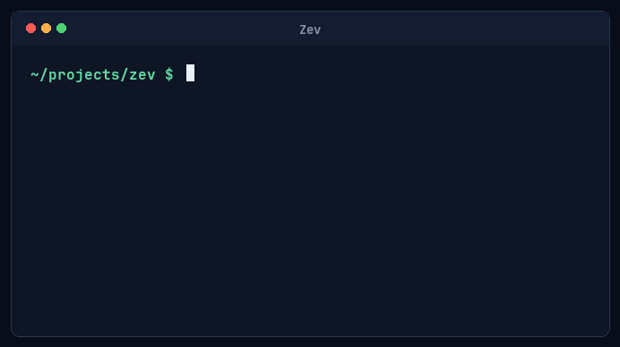

<div align="center">
<h1>Zev</h1>
<p>Terminal command suggestions from natural language — describe what you want, get the command</p>

<p>
    
    
    
    <a href="https://github.com/ra1phdd/zev/actions/workflows/ci.yml"></a>
</p>



**English** | [Русский](README.ru.md)
</div>

## Features

- Natural language in, terminal commands out — up to three options with a short
  explanation for each.
- Dangerous operations (`rm -rf`, `DROP TABLE`, `kubectl delete`) are flagged with a
  warning explaining exactly what the command will do.
- Five LLM providers: OpenAI, Gemini, Anthropic, Ollama and OpenCode.
- Custom base URLs — works with any OpenAI-compatible router.
- Interactive TUI selector: pick a suggestion with arrow keys, get it injected into your
  terminal or executed immediately.
- Command aliases with positional argument substitution — `zev dps my-service` runs your
  saved long command.
- Bash scripts with metadata, created straight in `$EDITOR` from the CLI.
- Persistent query history available offline in `~/.zev/history.db`, with no automatic
  count limit.
- Local lexical search with Russian/English stemming, bounded typo tolerance and
  exact-command filters.
- Semantic/hybrid history service support (CLI integration pending); embeddings are
  opt-in and limited to user requests/refinements.
- Verbosity control with `-v`, `-vv`, `-vvv`.

## Quick start

### Linux and macOS

Install the latest release with one command — the script picks the archive for your OS
and architecture and refuses to install unless `checksums.txt` is available, contains exactly
one valid SHA-256 entry for the archive, and a hash utility verifies a match:

```bash
# curl
curl -fsSL https://raw.githubusercontent.com/ra1phdd/zev/main/deploy/install.sh | bash

# or wget
wget -qO- https://raw.githubusercontent.com/ra1phdd/zev/main/deploy/install.sh | bash
```

Both install into `/usr/local/bin` with `sudo` when you have it, or fall back to
`$HOME/.local/bin` without root. To choose the directory yourself, set `PREFIX`:

```bash
PREFIX=$HOME/.local/bin curl -fsSL https://raw.githubusercontent.com/ra1phdd/zev/main/deploy/install.sh | bash
```

The script uses `curl` when available and falls back to `wget`. To install a specific
version, pass `-v`:

```bash
curl -fsSL https://raw.githubusercontent.com/ra1phdd/zev/main/deploy/install.sh | bash -s -- -v 1.0.0
```

### Windows

```powershell
irm https://raw.githubusercontent.com/ra1phdd/zev/main/deploy/install.ps1 | iex
```

Or download [`install.ps1`](deploy/install.ps1) and run `.\install.ps1`. It installs into
`%LOCALAPPDATA%\Programs\zev` and needs no administrator rights. SHA-256 verification is
mandatory here too: missing or invalid checksums, or a hash mismatch, stop installation.

### Then configure a provider

```bash
zev setup                          # interactive LLM provider setup
zev "find all files modified in the last 24 hours"
```

Without the `query` subcommand, `zev` starts its interactive prompt.

## Usage

### Query

```bash
zev "kill the process listening on port 8080"
zev query "list all docker containers by size"
```

### Choose what happens to the suggestion

```bash
zev --inject "compress the logs"   # put it in the terminal for review (default)
zev --execute "restart nginx"      # proxy stdout/stderr while it runs
```

`inject` shows warnings only; choosing a suggestion is not an approval and Zev never
presses Enter. `execute` is the secondary proxy mode: dangerous commands are warned
and confirmed before launch, then the child's stdout/stderr and exit status pass
through Zev. The default can be changed with `zev setup mode`. `security.mode: auto`
and `security.mode: bypass` are peer command-delivery modes;
`bypass` skips execute confirmation but does not change the separate tool-approval mode.

For an explicit literal argv proxy, use `run`; arguments are forwarded without shell
joining or reparsing:

```bash
zev run -- go test ./...
zev run -- printf '%s' '$HOME'
```

`zev run` forwards literal argv and is also used by query injection by default. On failure,
you can ask Zev to analyze the error or suggest a correction; suggestions are not executed.
Set `command_wrapper_enabled: false` in `~/.zev/config.yaml` to inject generated commands
without the `zev run` wrapper. Zev does not provide an OS sandbox.

### History

> SQLite history is Unreleased. The [History guide](docs/en/HISTORY.md) covers
> automatic migration, opt-in semantic search and explicit index maintenance.

```bash
zev history
zev history search "large files" --limit 20
zev history search "network error" --mode hybrid --json
zev history search --exact-command 'git status --short'
zev history show <conversation-id>
zev history index status --json
zev history index rebuild --fts
zev history export --format json
zev history delete <conversation-id>
zev history clear --yes
```

History is stored in SQLite at `~/.zev/history.db` with incremental conversation
records and no automatic count-based rotation. Enabled queries and explicit history
commands import the v1.0.0 `~/.zev/history` JSONL source through a separate importer,
then initialize the current SQLite store from one embedded SQL baseline (`.up.sql`).
The importer does not replay development SQLite schema history; development snapshots
are not backwards-compatible inputs. The source is removed only after verified import,
and no migration archive or backup copy is generated. `--no-history` and
`HISTORY_ENABLED=false` skip storage opening and migration for the current query. Search defaults to local lexical mode; semantic/hybrid uses separately
configured, opt-in embeddings and explicitly built user-message vectors. Vector rebuild
requires `--vectors --yes` consent; no vectors or RAG context are generated automatically.
JSON search results include coverage, truncation and `nextCursor` for `--cursor`
continuation. Deletion does not erase backups or external copies and provides no secure-erasure
guarantee.
See the [History guide](docs/en/HISTORY.md) for migration, search modes, privacy and
embedding configuration.

### Aliases

Store a long command once and call it by name. Arguments must be referenced explicitly
by `{{.argN}}` or `{{.args}}`; a template without placeholders rejects extra arguments:

```bash
zev alias add dps "docker service ps {{.arg1}} --no-trunc"
zev dps my-service

zev alias list
zev alias remove dps
```

Template variables: `{{.arg1}}`, `{{.arg2}}`, … emit one positional argument and
`{{.args}}` emits all original arguments as separate shell words. Placeholders must
stand alone. Aliases accept one simple command, not pipelines, redirects, or shell
substitution. Use a script for shell syntax. `zev dps --help` shows local help without
running the command or contacting a provider.

The supported v1.0.0 legacy metadata stores migrate to current v2 on first access without
generating an archive or backup copy. Development snapshot schemas are not backwards-
compatible inputs. Back up `~/.zev` yourself if you need a rollback option; Zev does not
sweep or delete user-owned backups or historical copies. Legacy templates outside the
restricted grammar block migration until manually repaired; do not downgrade a migrated
store to an older Zev version.

### Scripts

```bash
zev script create deploy "Deploy the application to production"
zev script list
zev script remove deploy
```

Metadata is stored in `~/.zev/scripts`, the script bodies — in `~/.zev/script_files`.
`zev script create` opens the file in `$SCRIPT_EDITOR`, `$EDITOR`, or the first available
of `nano`, `vim`, `vi`.

### Updating

```bash
zev update
```

Installs the latest stable GitHub Release with SHA-256 verification and immediately
runs all local migrations using the new binary. See the [update guide](docs/en/UPDATE.md)
for write permissions, recovery and offline migration retries.

### Other

```bash
zev version
zev -vv "tail the logs in real time"   # debug logs
```

## Providers

| Provider | `LLM_PROVIDER` | Required variables |
|---|---|---|
| OpenAI | `openai` | `OPENAI_API_KEY`, `OPENAI_MODEL`, `OPENAI_BASE_URL` |
| Gemini | `gemini` | `GEMINI_API_KEY`, `GEMINI_MODEL` |
| Anthropic | `anthropic` | `ANTHROPIC_API_KEY`, `ANTHROPIC_MODEL` |
| Ollama | `ollama` | `OLLAMA_BASE_URL`, `OLLAMA_MODEL` |
| OpenCode | `opencode` | `OPENAI_API_KEY`, `OPENAI_MODEL`, `OPENAI_BASE_URL` |

Ollama runs fully locally:

```bash
export LLM_PROVIDER=ollama
export OLLAMA_BASE_URL=http://localhost:11434/v1
export OLLAMA_MODEL=qwen2.5-coder
```

## Documentation

- [Configuration](docs/en/CONFIGURATION.md) — current YAML configuration, v1.0.0 migration,
  execution modes, files on disk
- [History](docs/en/HISTORY.md) — persistent SQLite history, migration, search and semantic opt-in
- [Aliases and scripts specification](docs/en/ALIASES-SCRIPTS-SPEC.md) — planned metadata, CLI, migration and argument contracts
- [Updating](docs/en/UPDATE.md) — self-update from GitHub Releases and immediate data migrations
- [Architecture](docs/en/ARCHITECTURE.md) — package map, query flow, provider contracts
- [Development](docs/en/DEVELOPMENT.md) — make targets, TDD workflow, conventions
- [Contributing](CONTRIBUTING.md) — how to propose and land a change
- [Project profile](PROJECT.md) — repository facts and operational limitations
- [Changelog](CHANGELOG.md) — release history

## Technology stack

- Go 1.27+, Cobra for the CLI
- Bubble Tea + Lipgloss for the terminal UI
- [go-openai](https://github.com/sashabaranov/go-openai) for OpenAI-compatible providers,
  [go-anthropic](https://github.com/liushuangls/go-anthropic) for Anthropic,
  raw HTTP for Gemini and OpenCode (SSE streaming)
- `godotenv` for v1.0.0 dotenv migration and `yaml.v3` for current configuration and metadata
- `golangci-lint`, `go vet` and `go test` through Make targets

## Uninstallation

To remove zev, use the uninstaller scripts:

```bash
# Linux and macOS
curl -fsSL https://raw.githubusercontent.com/ra1phdd/zev/main/deploy/uninstall.sh | bash
```

```powershell
# Windows
irm https://raw.githubusercontent.com/ra1phdd/zev/main/deploy/uninstall.ps1 | iex
```

The uninstaller asks whether to remove `~/.zev` (or the Windows `%USERPROFILE%\.zev`)
too. Answer `y` only if you want to delete configuration, history, aliases and scripts;
the default is to keep them. For non-interactive use, set `ZEV_REMOVE_CONFIG=1` to remove
that directory explicitly. In a shell pipeline, pass it to the shell running the script:
`curl -fsSL https://raw.githubusercontent.com/ra1phdd/zev/main/deploy/uninstall.sh | ZEV_REMOVE_CONFIG=1 bash`.

Or manually remove the binary:

```bash
rm /usr/local/bin/zev      # system-wide (Linux/macOS)
rm $HOME/.local/bin/zev    # user-local (Linux/macOS)
```

```cmd
REM Windows
del %LOCALAPPDATA%\Programs\zev\zev.exe
```

## Contributing

Contributions are welcome — read the [Contributing Guide](CONTRIBUTING.md).

## License

This project is licensed under the MIT License — see the [LICENSE](LICENSE) file.

## THIRD_PARTY

Zev uses the following direct third-party Go modules. Versions are pinned in
[`go.mod`](go.mod); [`go.sum`](go.sum) records module checksums.
Each dependency remains subject to its own license and copyright notices.

| Dependency | Version | License |
|---|---:|---|
| [BurntSushi/toml](https://github.com/BurntSushi/toml) | `v1.6.0` | MIT |
| [whatlanggo](https://github.com/abadojack/whatlanggo) | `v1.0.1` | MIT |
| [clipboard](https://github.com/atotto/clipboard) | `v0.1.4` | BSD-3-Clause |
| [env](https://github.com/caarlos0/env) | `v11.4.1` | MIT |
| [Bubbles](https://github.com/charmbracelet/bubbles) | `v1.0.0` | MIT |
| [Bubble Tea](https://github.com/charmbracelet/bubbletea) | `v1.3.10` | MIT |
| [Lip Gloss](https://github.com/charmbracelet/lipgloss) | `v1.1.0` | MIT |
| [google/uuid](https://github.com/google/uuid) | `v1.6.0` | BSD-3-Clause |
| [godotenv](https://github.com/joho/godotenv) | `v1.5.1` | MIT |
| [snowball](https://github.com/kljensen/snowball) | `v0.10.0` | MIT |
| [go-anthropic](https://github.com/liushuangls/go-anthropic) | `v2.25.0` | Apache-2.0 |
| [go-i18n](https://github.com/nicksnyder/go-i18n) | `v2.7.0` | MIT |
| [go-openai](https://github.com/sashabaranov/go-openai) | `v1.43.0` | Apache-2.0 |
| [Cobra](https://github.com/spf13/cobra) | `v1.10.2` | Apache-2.0 |
| [x/sys](https://pkg.go.dev/golang.org/x/sys) | `v0.49.0` | BSD-3-Clause |
| [x/term](https://pkg.go.dev/golang.org/x/term) | `v0.47.0` | BSD-3-Clause |
| [x/text](https://pkg.go.dev/golang.org/x/text) | `v0.43.0` | BSD-3-Clause |
| [yaml.v3](https://github.com/go-yaml/yaml) | `v3.0.1` | MIT and Apache-2.0 |
| [modernc.org/sqlite](https://gitlab.com/cznic/sqlite) | `v1.62.0` | BSD-3-Clause |

License texts and copyright notices are provided by the respective upstream
projects. This table covers direct application dependencies; transitive dependencies
are resolved and integrity-pinned through the Go module files.
