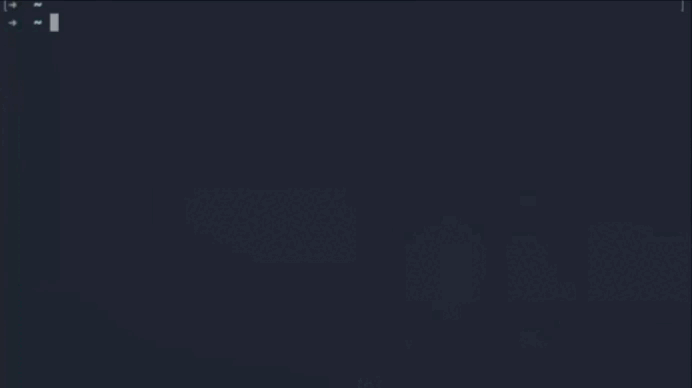

<div align="center">
<h1>Zev</h1>
<p>Подсказки команд терминала на естественном языке — опишите задачу, получите команду</p>

<p>
    
    
    
</p>



**English** | [Русский](README.ru.md)
</div>

## Возможности

- Естественный язык на входе, команды терминала на выходе — до трёх вариантов с кратким
  пояснением к каждому.
- Опасные операции (`rm -rf`, `DROP TABLE`, `kubectl delete`) помечаются предупреждением с
  описанием того, что именно сделает команда.
- Пять LLM-провайдеров: OpenAI, Gemini, Anthropic, Ollama и OpenCode.
- Пользовательский base URL — работает с любым OpenAI-совместимым роутером.
- Интерактивный TUI-селектор: выберите подсказку стрелками, она попадёт в терминал или
  выполнится сразу.
- Алиасы команд с подстановкой позиционных аргументов — `zev dps my-service` выполнит вашу
  длинную сохранённую команду.
- Bash-скрипты с метаданными, создаются прямо из CLI в `$EDITOR`.
- История запросов (последние 100) доступна офлайн в `~/.zevhistory`.
- Уровень логирования через `-v`, `-vv`, `-vvv`.

## Быстрый старт

### Linux и macOS

Установите последний релиз одной командой — скрипт сам подберёт архив под вашу ОС и
архитектуру, проверит SHA-256 и установит бинарник:

```bash
# curl
curl -fsSL https://raw.githubusercontent.com/ra1phdd/zev/main/deploy/install.sh | bash

# или wget
wget -qO- https://raw.githubusercontent.com/ra1phdd/zev/main/deploy/install.sh | bash
```

Оба варианта ставят в `/usr/local/bin` через `sudo`, если он есть, а без прав root — в
`$HOME/.local/bin`. Чтобы выбрать каталог самостоятельно, укажите `PREFIX`:

```bash
PREFIX=$HOME/.local/bin curl -fsSL https://raw.githubusercontent.com/ra1phdd/zev/main/deploy/install.sh | bash
```

Скрипт использует `curl`, если он есть, иначе `wget`. Чтобы поставить конкретную версию,
передайте `-v`:

```bash
curl -fsSL https://raw.githubusercontent.com/ra1phdd/zev/main/deploy/install.sh | bash -s -- -v 1.0.0
```

### Windows

```powershell
irm https://raw.githubusercontent.com/ra1phdd/zev/main/deploy/install.ps1 | iex
```

Или скачайте [`install.ps1`](deploy/install.ps1) и запустите `.\install.ps1`. Ставит в
`%LOCALAPPDATA%\Programs\zev`, права администратора не нужны.

### Затем настройте провайдера

```bash
zev setup                          # интерактивная настройка LLM-провайдера
zev "найти все файлы, изменённые за последние 24 часа"
```

Без подкоманды `query` запускается интерактивный режим.

## Использование

### Запрос

```bash
zev "убить процесс, слушающий порт 8080"
zev query "показать все docker-контейнеры по размеру"
```

### Что делать с выбранной командой

```bash
zev --inject "сжать логи"      # подставить в терминал для проверки (по умолчанию)
zev --execute "перезапустить nginx"   # выполнить сразу
```

Поведение по умолчанию берётся из `COMMAND_EXECUTION_MODE` и меняется через
`zev setup mode`.

### История

```bash
zev history          # посмотреть предыдущие запросы
```

### Алиасы

Сохраните длинную команду один раз и вызывайте по имени. Лишние аргументы
дописываются автоматически либо подставляются в шаблон:

```bash
zev alias add dps "docker service ps {{.arg1}} --no-trunc"
zev dps my-service

zev alias list
zev alias remove dps
```

Переменные шаблона: `{{.arg1}}`, `{{.arg2}}`, … — позиционные аргументы, `{{.args}}` —
все аргументы через пробел.

### Скрипты

```bash
zev script create deploy "Деплой приложения в продакшен"
zev script list
zev script remove deploy
```

Метаданные хранятся в `~/.zev/scripts`, тела скриптов — в `~/.zev/script_files`.
`zev script create` открывает файл в `$SCRIPT_EDITOR`, `$EDITOR` или первом доступном из
`nano`, `vim`, `vi`.

### Прочее

```bash
zev version
zev -vv "смотреть логи в реальном времени"   # debug-логи
```

## Провайдеры

| Провайдер | `LLM_PROVIDER` | Обязательные переменные |
|---|---|---|
| OpenAI | `openai` | `OPENAI_API_KEY`, `OPENAI_MODEL`, `OPENAI_BASE_URL` |
| Gemini | `gemini` | `GEMINI_API_KEY`, `GEMINI_MODEL` |
| Anthropic | `anthropic` | `ANTHROPIC_API_KEY`, `ANTHROPIC_MODEL` |
| Ollama | `ollama` | `OLLAMA_BASE_URL`, `OLLAMA_MODEL` |
| OpenCode | `opencode` | `OPENAI_API_KEY`, `OPENAI_MODEL`, `OPENAI_BASE_URL` |

Ollama работает полностью локально:

```bash
export LLM_PROVIDER=ollama
export OLLAMA_BASE_URL=http://localhost:11434/v1
export OLLAMA_MODEL=qwen2.5-coder
```

## Документация

- [Конфигурация](docs/ru/CONFIGURATION.md) — `~/.zevrc`, переменные окружения, режимы
  выполнения, файлы на диске
- [Архитектура](docs/ru/ARCHITECTURE.md) — карта пакетов, путь запроса, контракты
  провайдеров
- [Разработка](docs/ru/DEVELOPMENT.md) — make-цели, TDD, соглашения проекта
- [Contributing](docs/ru/CONTRIBUTING.md) — как предложить и принять изменение

## Технологии

- Go 1.27+, Cobra для CLI
- Bubble Tea + Lipgloss для терминального UI
- [go-openai](https://github.com/sashabaranov/go-openai) для OpenAI-совместимых
  провайдеров, raw HTTP для Gemini, Anthropic и OpenCode (SSE streaming)
- `godotenv` + `caarlos0/env` для конфигурации
- `golangci-lint` и `go test` в CI

## Удаление

Чтобы удалить zev, воспользуйтесь скриптами:

```bash
# Linux и macOS
curl -fsSL https://raw.githubusercontent.com/ra1phdd/zev/main/deploy/uninstall.sh | bash
```

```powershell
# Windows
irm https://raw.githubusercontent.com/ra1phdd/zev/main/deploy/uninstall.ps1 | iex
```

Или удалите бинарник вручную:

```bash
rm /usr/local/bin/zev      # системная установка (Linux/macOS)
rm $HOME/.local/bin/zev    # пользовательская (Linux/macOS)
```

```cmd
REM Windows
del %LOCALAPPDATA%\Programs\zev\zev.exe
```

## Contributing

Приветствуем вклад — читайте [гайд по участию](docs/ru/CONTRIBUTING.md).

## Лицензия

Проект лицензирован по MIT License — см. файл [LICENSE](LICENSE).
